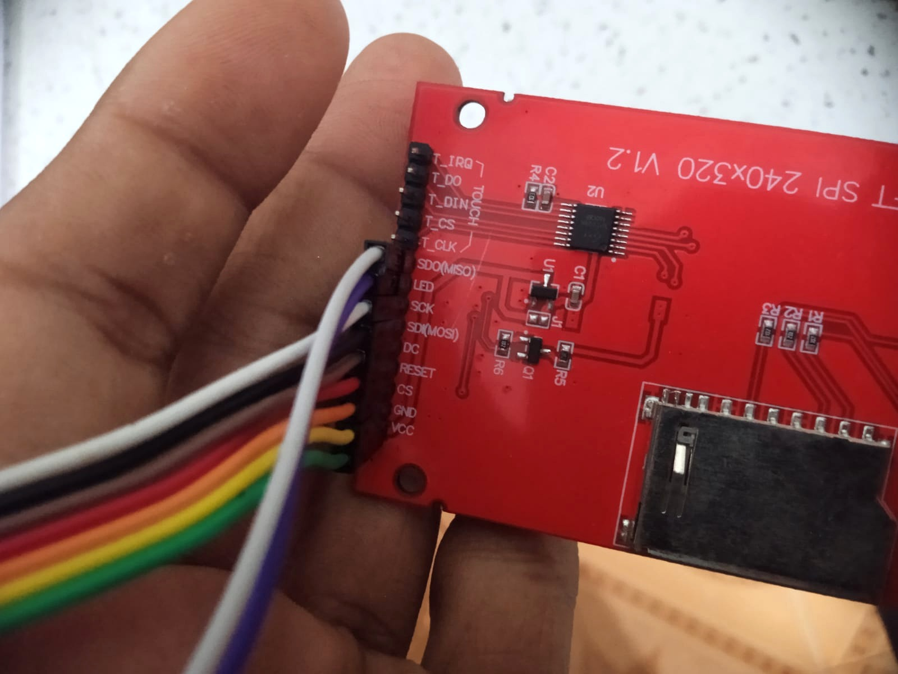
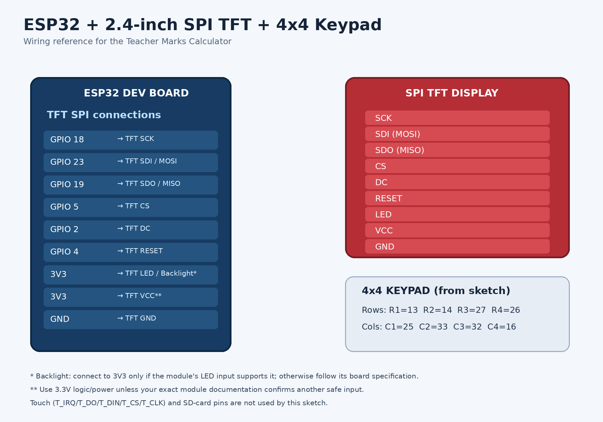

# Teacher Marks Calculator

Hi! This is my ESP32-based Teacher Marks Calculator. I made it to enter students' marks, calculate results and view student rankings.

## Features
- Enter marks for 6 subjects.
- Calculate total and percentage.
- Check pass or fail.
- View student rankings.
- Edit student and subject names using Wi-Fi.
- Download marks as a CSV file.

## Components
- ESP32 development board
- 2.4-inch SPI TFT display (240×320)
- 4×4 matrix keypad
- Jumper wires and breadboard
- USB data cable

## Display – Back Side

This is the back side of the TFT display I am using. The labels printed beside the connector show the display, touch and SD-card signals.

## ESP32 Wiring Diagram

### TFT display pin connections

The following is the proposed pin mapping for my ESP32 setup. I need to use the same GPIO numbers in the `TFT_eSPI` configuration.

| TFT display pin | ESP32 connection |
|---|---|
| SCK | GPIO 18 |
| SDI (MOSI) | GPIO 23 |
| SDO (MISO) | GPIO 19 |
| CS | GPIO 5 |
| DC | GPIO 2 |
| RESET | GPIO 4 |
| LED | 3.3V* |
| VCC | 3.3V** |
| GND | GND |

**Touch and SD-card pins:** `T_IRQ`, `T_DO`, `T_DIN`, `T_CS`, `T_CLK` and the microSD interface pins are not used by my current sketch, so I leave them unconnected.

### 4×4 keypad connections

These GPIO numbers are used in my code:

| Keypad pin | ESP32 GPIO |
|---|---:|
| R1 | 13 |
| R2 | 14 |
| R3 | 27 |
| R4 | 26 |
| C1 | 25 |
| C2 | 33 |
| C3 | 32 |
| C4 | 16 |

## Required Arduino Libraries
- `TFT_eSPI`
- `Keypad`

The ESP32 board package includes the Wi-Fi and storage libraries used by the sketch.

## How I Upload the Code
1. Install Arduino IDE and ESP32 board support.
2. Install the libraries listed above.
3. Configure `TFT_eSPI` with the TFT pins in the table above and select the correct display driver.
4. Open `Teacher_Marks_Calculator_SD_Fixed.ino`.
5. Connect the ESP32 using a USB data cable.
6. Select the correct ESP32 board and COM port.
7. Click **Verify**, then **Upload**.
8. If upload stays at `Connecting...`, hold the ESP32 **BOOT** button while the upload starts.

## Wi-Fi Setup
1. Long-press `#` on the keypad to start Wi-Fi mode.
2. Connect to **Marks_Name_Edit**.
3. Password: **12345678**
4. Open the IP address shown on the TFT screen in a browser (normally `192.168.4.1`).
5. Edit names or download the marks CSV file.
6. Press `*` to exit Wi-Fi mode.

## Project Settings
- 6 subjects
- 30 students by default
- Up to 50 students
- Pass mark: 35 per subject

## Notes
- The TFT pin mapping above is a suggested wiring plan, not a pin map detected from the uploaded photo or sketch. Match it in `TFT_eSPI` before uploading.
- * Connect the backlight pin to 3.3V only if the display module supports that connection. Some boards need a different backlight arrangement.
- ** Power the module from 3.3V unless its documentation confirms that its VCC input accepts another voltage. Do not assume every TFT breakout is 5V tolerant.
- Check the pin labels and module specifications before applying power.

This is my project. I hope it is useful, and I welcome suggestions and improvements!
